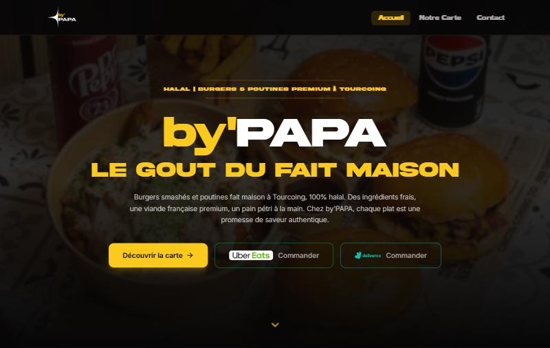
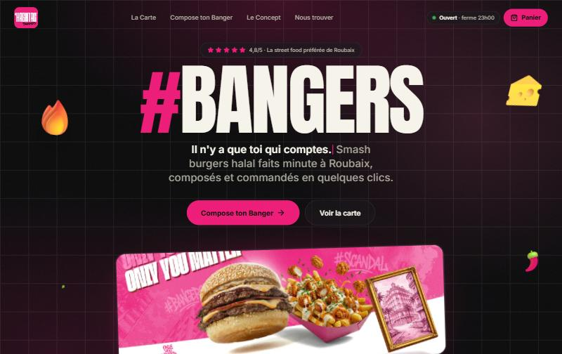
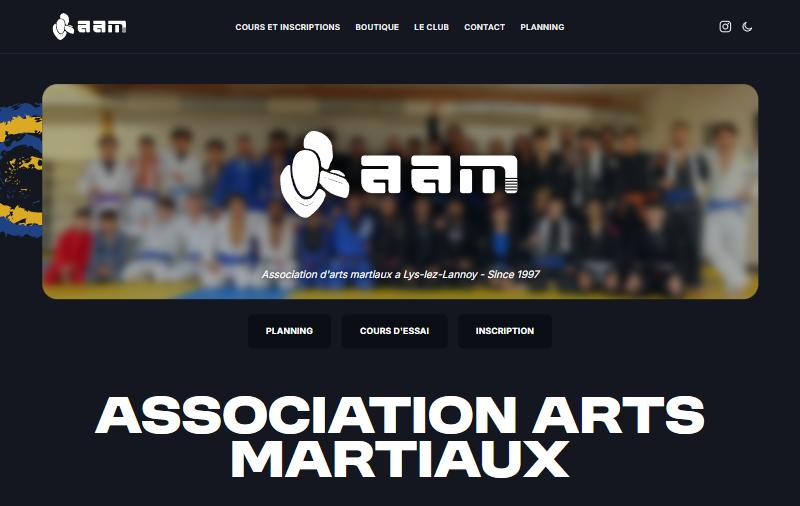
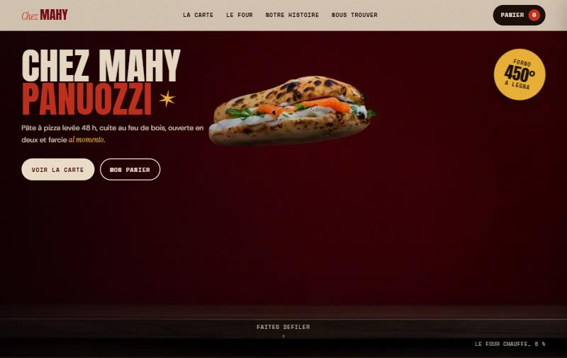
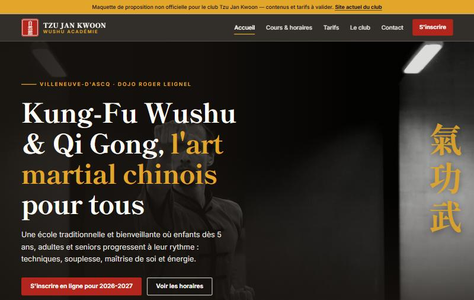
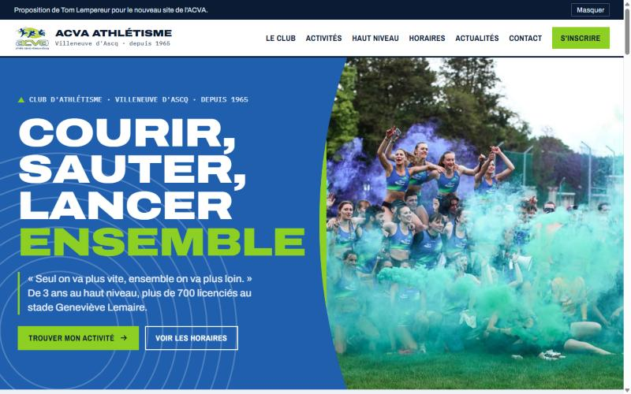

# Salut 👋, moi c'est Tom

Développeur web & applications, fondateur du studio de webdesign **[Snakehound](https://snakehound.fr)**, je crée des sites, des applis et des outils sur mesure.

# 🚀 Projets à la une

| Projet | Description | Stack |
|----------|-------------|-------|
| **[Snakehound](https://snakehound.fr)** | Le site de mon studio de webdesign, avec deux effets interactifs sur mesure : un rideau de peinture à « vaporiser » au chargement et des cartes de service animées | **Frontend :** React, Vite, TypeScript   **Hébergement :** Vercel |
| **SaveNomad** | Outil pour reprendre une partie sur n'importe quel appareil : synchronise les sauvegardes in-game des émulateurs (RetroArch, Dolphin, PCSX2 / NetherSX2, PPSSPP) entre PC Windows, Linux et consoles Android. Ne supprime jamais rien, gère les conflits et propose un mode `--dry-run` | **Langage :** Python 3.9+ (sans dépendance)   **Sync :** Syncthing / cloud |
| **[Portfolio](https://github.com/LempereurTom/portfolio-custom)** | Portfolio personnel inspiré de l'univers papier découpé de Little Big Planet et Tearaway : fond de cahier quadrillé, navigation en stickers dessinés à la main, effet de tilt 3D au survol | **Frontend :** HTML, CSS pur (aucun framework) |
| **[Cubes Python](https://github.com/LempereurTom/Cubes_Python)** | Jeu de construction en voxels à la première personne : poser et casser des blocs (herbe, pierre, brique, terre), skybox, modèles 3D faits sous Blender | **Moteur :** Python, Ursina   **3D :** Blender |

---

# 🌐 Sites clients

<table>
<tr>
<td width="50%" valign="top">
 
<a href="https://www.bypapa.fr"><b>by'PAPA</b></a>  
Site d'un snack de burgers smashés et poutines faits maison à Tourcoing : carte à onglets, contact avec carte OpenStreetMap, SEO local (Schema.org) et accessibilité Opquast 
<b>Stack :</b> React, Vite, Tailwind CSS 4, React Router, Vercel
</td>
<td width="50%" valign="top">
 
<b>Hashtag Bangers</b>  
Refonte du site d'un restaurant de smash burgers & fried chicken à Roubaix : hero animé, burgers en scroll horizontal épinglé, carte de 79 produits, horaires avec statut ouvert/fermé en temps réel 
<b>Stack :</b> Next.js 16, React 19, Tailwind CSS 4, Motion, Lenis
</td>
</tr>
<tr>
<td width="50%" valign="top">
 
<b>AAM Delariva</b>  
Nouveau site du club de Jiu-Jitsu Brésilien de Lys-lez-Lannoy, pour remplacer l'ancien WordPress : cours et planning, boutique, actualités et inscriptions via HelloAsso 
<b>Stack :</b> Astro
</td>
<td width="50%" valign="top">
 
<b>Chez Mahy</b>  
Proposition pour un restaurant italien de Roubaix : intro vidéo pilotée par le défilement (séquence sur canvas), carte par catégories et panier de démonstration 
<b>Stack :</b> HTML, CSS, JavaScript natifs
</td>
</tr>
<tr>
<td width="50%" valign="top">
 
<b>Tzu Jan Kwoon</b>  
Proposition de refonte pour un club de Kung-Fu et Qi Gong de Villeneuve-d'Ascq : inscription en ligne en 4 étapes avec calcul automatique des cotisations, bonnes pratiques Opquast 
<b>Stack :</b> HTML, CSS, JavaScript
</td>
<td width="50%" valign="top">
 
<b>ACVA Athlétisme</b>  
Proposition de nouveau site pour l'Athlétic Club de Villeneuve d'Ascq, accompagnée d'un audit complet du site actuel 
<b>Stack :</b> HTML, CSS, JavaScript
</td>
</tr>
</table>

---

# 🆕 Derniers dépôts publics

<!-- PROJETS:START -->
| Projet | Description | Langage | Mis à jour |
|---|---|---|---|
| **[portfolio-custom](https://github.com/LempereurTom/portfolio-custom)** |  | HTML | 2026-05-21 |
| **[Cubes_Python](https://github.com/LempereurTom/Cubes_Python)** |  |  | 2022-12-28 |
<!-- PROJETS:END -->

---

# 📊 Statistiques GitHub

